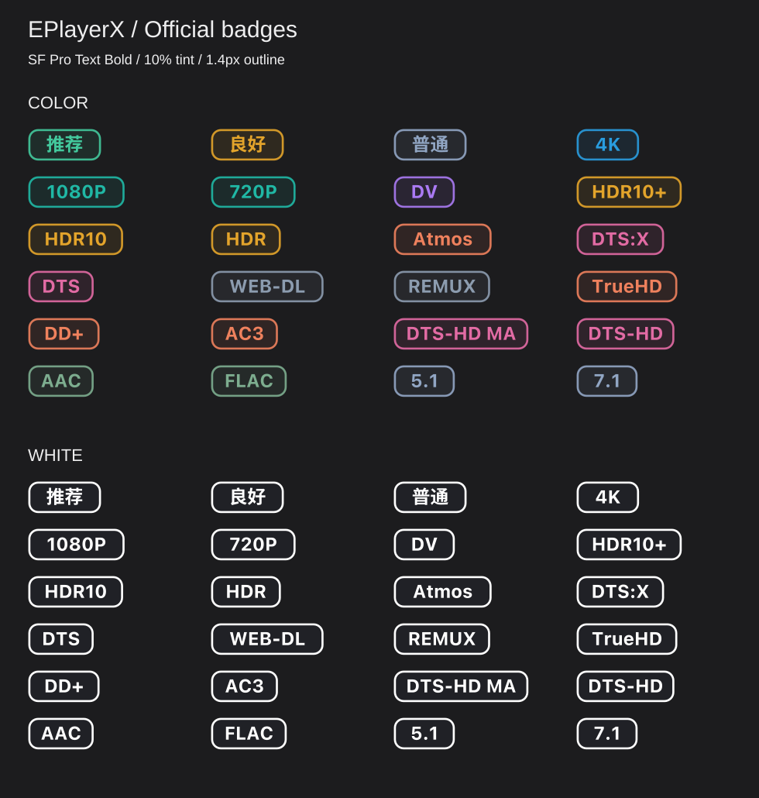

# EPlayerX 资源徽章 · 彩色 / 白色正式版 · Ai神力制作

两套配色、四份正式配置。统一使用 **10% 半透明底色、1.4px 描边、6px 圆角、22px 高度**。

- **彩色版**：保留原有格式分类配色，文字与描边使用对应颜色，底色为同色的 10%；描边不透明度 90%。
- **白色版**：纯白文字和描边，深灰色 `#333333` 底色，不透明度 10%；描边不透明度 100%。
- 英文与数字使用 **SF Pro Text Bold**，已转换为 SVG 路径，设备无需安装字体；中文评级使用 iOS 中文系统字体（PingFang SC 等字体回退），保留中文文字，并使用同色 0.30px 字形描边增强笔画，使视觉粗细更接近英文粗体。
- 每种配色都提供「推荐评级版」与「无评级版」。两种配色的匹配规则一致，不会随系统主题自动切换。

## 四个正式导入地址

| 配色 / 版本 | 规则数 | 配置 |
| --- | ---: | --- |
| 彩色 · 推荐评级版 | 24 | [打开 JSON](https://raw.githubusercontent.com/MiaoWaa/EPlayerX-Badges/main/badges-recommend-regex-v2.json) |
| 彩色 · 无评级版 | 21 | [打开 JSON](https://raw.githubusercontent.com/MiaoWaa/EPlayerX-Badges/main/badges-no-rating.json) |
| 白色 · 推荐评级版 | 24 | [打开 JSON](https://raw.githubusercontent.com/MiaoWaa/EPlayerX-Badges/main/badges-white-recommend.json) |
| 白色 · 无评级版 | 21 | [打开 JSON](https://raw.githubusercontent.com/MiaoWaa/EPlayerX-Badges/main/badges-white-no-rating.json) |

**彩色 · 推荐评级版（兼容原地址）**

```text
https://raw.githubusercontent.com/MiaoWaa/EPlayerX-Badges/main/badges-recommend-regex-v2.json
```

**彩色 · 无评级版（兼容原地址）**

```text
https://raw.githubusercontent.com/MiaoWaa/EPlayerX-Badges/main/badges-no-rating.json
```

**白色 · 推荐评级版**

```text
https://raw.githubusercontent.com/MiaoWaa/EPlayerX-Badges/main/badges-white-recommend.json
```

**白色 · 无评级版**

```text
https://raw.githubusercontent.com/MiaoWaa/EPlayerX-Badges/main/badges-white-no-rating.json
```

## 实际素材预览

下图由正式版 SVG 直接组合，展示两套完整素材；实际徽章数量、顺序与大小由资源文本、匹配结果和 EPlayerX 页面布局决定。



| 示例 | 实际 SVG |
| --- | --- |
| 彩色 · 推荐评级版 |       |
| 彩色 · 无评级版 |      |
| 白色 · 推荐评级版 |       |
| 白色 · 无评级版 |      |

上方完整预览使用深色底，方便观察白色版。底色为半透明叠加，外观会受页面背景影响，文字与描边本身使用固定颜色。

## 安装与切换

1. 在 EPlayerX 设置中找到资源徽章的自定义 JSON 配置入口。
2. 粘贴所选版本的完整 Raw 地址并启用。
3. **四份正式配置只启用一份**；切换前停用其他正式版、测试版或第三方徽章配置，避免重复显示。
4. 更新后刷新配置；若仍显示旧图，重新导入。新的正式图标路径与测试版、旧版不同。

不同 EPlayerX 版本的设置入口可能有差异。JSON 和图片均需能访问 `raw.githubusercontent.com`。仓库只保留四份正式配置、正在使用的图标与预览；测试目录和未使用的旧素材已清理。

## 支持的规则与评级含义

两种配色均包含相同的 **21 条客观信息规则**：

- 分辨率（3）：4K、1080P、720P。
- 动态范围（4）：DV、HDR10+、HDR10、HDR。
- 音频格式（10）：Atmos、DTS:X、DTS、TrueHD、DD+、AC3、DTS-HD MA、DTS-HD、AAC、FLAC。
- 片源（2）：WEB-DL、REMUX。
- 声道（2）：5.1、7.1。

推荐评级版另含 **3 条动态范围提示规则**：

| 提示 | 匹配依据 |
| --- | --- |
| 推荐 | DV / DoVi / Dolby Vision，或 HDR10+ |
| 良好 | HDR10 / HDR，且未命中上述标记 |
| 普通 | 明确标注 SDR，且未命中 HDR / DV |

这些提示只反映文本中的动态范围标记，**不是码率、清晰度、压制质量或实际观感的综合评分**；SDR 不等于低画质。没有可识别的动态范围信息时不强制显示评级。无评级版真正移除了评级分组和三条规则，仍保留 DV、HDR 等格式信息。

彩色版沿用原有分类：蓝/青绿用于分辨率，紫色用于 DV，金黄用于 HDR 系列，橙色用于 Dolby 音频，粉色用于 DTS 系列，绿色用于 AAC/FLAC，灰蓝用于片源与声道。颜色不构成统一的画质评级。

## 常见问题

**为什么没有某个徽章？** 配置使用正则匹配 EPlayerX 提供的资源文本，没有相应关键字或写法不同可能不显示，不等同于媒体流实际检测。

**为什么重复显示？** 检查是否同时启用了多份配置，尤其是先前导入的测试版。

**为什么白色版不自动变为深色文字？** 当前 SVG 使用固定文字和描边颜色；半透明底色透出页面背景不代表自动主题切换。白色版使用固定的白色文字；请根据实际背景选择合适配色。

**为什么保留原配置文件名？** 为兼容已导入的彩色版地址，继续使用原文件名。四份正式配置仅引用 `icons/color-sf10/` 或 `icons/white-gray10/` 中正在使用的素材。测试版配置已移除，请改用上方四个正式地址之一。

**暂不支持什么？** 不含 H.264、HEVC 等编码徽章；不承诺识别真实编码或设备播放能力。

## 目录

```text
README.md
badges-recommend-regex-v2.json   # 彩色 · 推荐评级版
badges-no-rating.json           # 彩色 · 无评级版
badges-white-recommend.json     # 白色 · 推荐评级版
badges-white-no-rating.json     # 白色 · 无评级版
icons/color-sf10/               # 彩色正式素材，24 个 SVG
icons/white-gray10/             # 白色正式素材，24 个 SVG
previews/official-badges.svg    # 实际素材组合预览
```

本项目为个人维护的 EPlayerX 自定义徽章配置，**非 EPlayerX 官方项目**。
